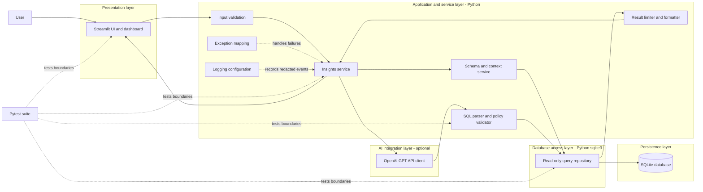

# INSIGHTSQL System Architecture

> **Status:** The architecture remains the design reference. A local Streamlit/Python implementation is now present in this folder and its automated tests pass; the OpenAI API has not been live-tested, and shared/hosted deployment remains proposed.

## System overview

INSIGHTSQL is a local-first, read-only reporting application. Streamlit presents a question-and-results workflow. Python coordinates deterministic schema retrieval, request validation, SQL validation, controlled execution, result formatting, and error handling. The OpenAI GPT API is an optional language service that proposes SQL from a minimized schema context. It cannot connect to SQLite or execute queries. Post-query AI explanations are a future option and are not implemented; current results are not sent to the provider.

The initial configurable data source is `D:\SQL_APP1\DBINSIGHT\dbinsight.db`, containing `departments`, `employees`, `projects`, and `employee_projects`. The architecture must preserve that database and support a different explicitly configured SQLite file without changing code.

## Architecture principles

1. **Read-only by default:** the reporting path uses a SQLite URI with `mode=ro` and enables `PRAGMA query_only=ON`.
2. **Validate before execution:** generated and user-supplied SQL pass one centralized, parser-based policy gate. SQLite read-only mode is a defense-in-depth control, not a substitute for SQL validation.
3. **AI is advisory:** GPT returns an untrusted SQL suggestion and SQL-oriented explanation. Deterministic application code owns authorization, validation, execution, limits, and formatting.
4. **Least data shared:** send schema metadata, not table contents, to SQL generation. Do not send query results to the provider; any future explanation feature requires explicit privacy review and user opt-in.
5. **Explicit configuration:** resolve and validate the configured database path at startup; never let a prompt choose arbitrary files.
6. **Bounded work:** enforce a request size, SQL length, execution deadline, row limit, and AI timeout/retry budget.
7. **Observable, private failures:** use structured application logs for diagnostics while withholding credentials, SQL result contents, and sensitive values.
8. **Testable boundaries:** inject configuration, the database path, and the AI client so unit tests can mock external services and integration tests can use disposable databases.

## Layered architecture

## Component responsibilities

| Component | Responsibility and boundary |
|---|---|
| Streamlit UI | Collect a question, show progress, render approved results and safe errors. It does not construct executable SQL or connect to SQLite. |
| Request validator | Enforce non-empty text, maximum length, encoding/shape expectations, and UI request limits before service calls. |
| Insights service | Orchestrate deterministic and AI-assisted paths; hold no direct SQL execution privilege beyond calling the repository interface. |
| Schema/context service | Read allowed schema metadata and foreign-key relationships; omit row values and restrict context to approved tables. |
| OpenAI client adapter | Send minimized prompts, apply bounded timeouts, parse typed responses, and expose provider errors without secrets. |
| SQL policy validator | Parse one candidate statement, require an approved read-only query form, reject prohibited operations/functions, and enforce policy before execution. |
| Read-only query repository | Open the configured database in read-only mode, apply SQLite-level controls and limits, execute approved SQL, and close resources reliably. |
| Result processor | Enforce row/column and output-size bounds, normalize values, and format safe tables or summaries. |
| Exception mapper | Convert expected internal errors to stable user-facing messages and correlate them with redacted logs. |
| Logging configuration | Configure Python logging once, emit lifecycle and timing events, and redact secrets and sensitive payloads. |
| Pytest suite | Verify layers independently and together using mocks and temporary SQLite databases. |

## Deterministic operations versus AI suggestions

**Deterministic application operations:** configuration resolution, schema reads, input checks, SQL policy decisions, query execution, row limiting, result formatting, database integrity behavior, error mapping, and logging. These remain under application control and should work without GPT where applicable.

**AI-generated, untrusted outputs:** the implemented provider path returns proposed SQL and a short explanation of that SQL. These outputs are suggestions, not authorization. Generated SQL is never displayed as executable/approved until the validator accepts it; only the repository can execute it. Post-query result explanations or summaries are future features, not currently implemented.

## Technology choices

- **Streamlit:** rapid local interactive UI and dashboard. Keep UI code thin and call typed service functions.
- **Python:** service orchestration, validation, configuration, logging, and integration boundaries.
- **`sqlite3`:** Python built-in database driver; no external database driver is required for SQLite.
- **SQLite:** existing local relational store. Open reporting connections read-only and do not run migrations or seed scripts.
- **OpenAI GPT API:** optional natural-language SQL suggestion. Post-query result explanation is a proposed future feature. Keep provider access behind an adapter so tests and future providers do not couple to UI or storage.
- **Pytest:** unit and integration test runner. Use temporary database files and mocks; no ordinary test needs a live key.

## Proposed interfaces

These are conceptual contracts. The current implementation uses corresponding modules/classes:

| Interface | Input | Output |
|---|---|---|
| Query orchestration (`QueryService`) | Question, candidate SQL, and optional bound parameters | Fresh validation, bounded result, and persistent execution status |
| Schema retrieval (`SchemaService`) | Configured database path | Table/column/type/relationship metadata only |
| SQL suggestion (`SqlGenerator`) | Validated question and minimized schema | Untrusted SQL and explanation or typed provider failure |
| SQL policy (`SqlValidator`) | One candidate SQL string and live schema | `ValidationResult` and validator-created `ApprovedQuery` |
| Read-only execution (`ReadOnlyDatabase`) | Approved query, bounded parameters | Bounded result set or typed database/timeout error |
| Optional result explanation | Not implemented | Future feature; result data is not currently sent to an AI provider |

## Deployment approach

The implemented deployment target is a single-user local Streamlit process on the user's workstation. Configuration is read from environment variables, optionally populated from a local `.env` excluded from version control. The database path is explicitly configured, resolved, and checked for an existing file. No database or API key is bundled with the application.

For a future shared deployment, add authenticated access, per-user authorization, a managed secret store, controlled database placement, network restrictions, concurrency/resource limits, and an explicit data-sharing review before exposing the service. Do not treat the local single-user design as production-ready for multiple users.

## Assumptions and non-goals

- This deliverable contains architecture documentation and a placeholder-only `.env.example`; no application, dependency manifest, or real `.env` is created here.
- The existing database is an input data source, not an application-owned schema to migrate.
- User-selected queries are reporting queries only. Writes, schema changes, extension loading, attachment of other databases, and arbitrary file access are outside the product scope.
- AI output can be wrong or maliciously influenced by database metadata; validation and execution controls remain mandatory.
