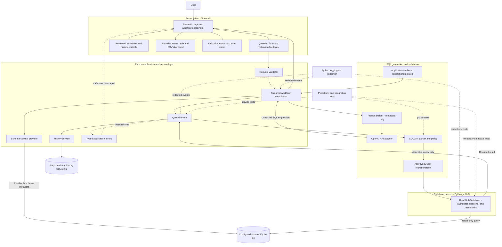

# INSIGHTSQL Component Design

> **Status:** Current local components are implemented in `app.py` and `src/insightsql/`. Post-query AI explanation, authentication, and hosted deployment are not implemented; external provider behavior has not been live-tested.

## Component diagram

## Streamlit UI components

- **Question/report form:** accepts a natural-language request or an application-authored report-template selection and applies required-field and length checks.
- **Validation/status feedback:** reports input errors, SQL policy results, and safe provider/database failures.
- **Result table:** displays bounded, escaped values and explicit truncation status.
- **History controls:** list local query attempts, reuse a prior question, clear history after confirmation, and revalidate SQL before a historical rerun.
- **Error panel:** shows safe, actionable messages.
- **UI boundary:** coordinates schema, generation, validation, execution, and history services. It does not open a database connection or execute SQL itself.

## Python service layer

`QueryService` revalidates candidate SQL, delegates approved queries to the read-only database service, and records outcomes through the history service. The Streamlit entry point coordinates schema retrieval and SQL generation. Provider unavailability is surfaced rather than disguised as a successful arbitrary query; without a key, only explicit reviewed examples are available.

## SQL generation and validation components

1. **Prompt builder:** includes only the user's validated question and approved schema metadata. It instructs GPT to return a single query suggestion and not to claim that it has executed the query.
2. **OpenAI adapter:** handles authentication, response parsing, a bounded request/response size, and a request timeout. The API key is read from the process environment. Automatic retries are not implemented.
3. **SQL parser:** SQLGlot parses the complete candidate using the SQLite dialect. Do not rely on substring matching or a regex blacklist as the primary parser.
4. **Policy validator:** SQLGlot requires exactly one statement and an approved read-only `SELECT` (or carefully verified read-only CTE ending in `SELECT`); it rejects write/DDL/administrative statements, multiple statements, disallowed functions, unapproved tables, and unsupported constructs.
5. **Approved query representation:** only the validator can construct it. The repository accepts this representation rather than arbitrary UI/provider text.

## SQLite database access layer

`SchemaService` reads schema metadata from the configured path. `ReadOnlyDatabase` resolves that same trusted configuration, opens query connections with a SQLite URI using `mode=ro`, applies query-only and authorizer controls, installs a progress handler for deadlines, bounds rows and output bytes, and closes resources. The current local app does not enforce a fixed filesystem-root allowlist; the prompt cannot select or alter the configured path.

The configured default for the initial local setup is `D:\SQL_APP1\DBINSIGHT\dbinsight.db`. The path is not hard-coded as an authorization decision; an administrator/user explicitly configures the permitted source.

## OpenAI GPT integration

The provider adapter is optional and isolated from storage. SQL generation receives schema metadata, not full records. It returns an untrusted SQL candidate and SQL-oriented explanation; every candidate is validated before execution. Query results are not sent to the provider. Post-query explanations are future work requiring explicit data-minimization and opt-in design.

## Logging and exception-handling components

Use Python's standard `logging` module, configured once at application startup. The redaction/filter boundary masks common credential forms; logs avoid prompts, returned records, and full SQL. Typed application exceptions distinguish invalid input, rejected SQL, configuration, database, timeout, and provider failures. The Streamlit entry point maps expected failures to safe messages; centralized correlation IDs are future work.

## Pytest testing components

- Unit tests cover validators, policy, result bounds, exception mapping, and redaction.
- Service tests mock schema, repository, and provider interfaces.
- Integration tests create an isolated SQLite file under a temporary directory and verify connection, schema, foreign keys, query limits, timeout behavior, and cleanup.
- Provider tests use mocks; no ordinary test needs a real API key.
- No test may open the existing `DBINSIGHT\dbinsight.db` in a write-capable mode.

## Dependencies and interfaces

The Streamlit entry point coordinates schema, generation, query, and history services. The provider adapter uses environment configuration and HTTP, not SQLite. `QueryService` depends on the validator, read-only database service, and history service; the database service depends on Python `sqlite3` and validator-approved query objects. Logging and typed exceptions are shared cross-cutting facilities. Pytest tests these boundaries using mocks and temporary databases.
