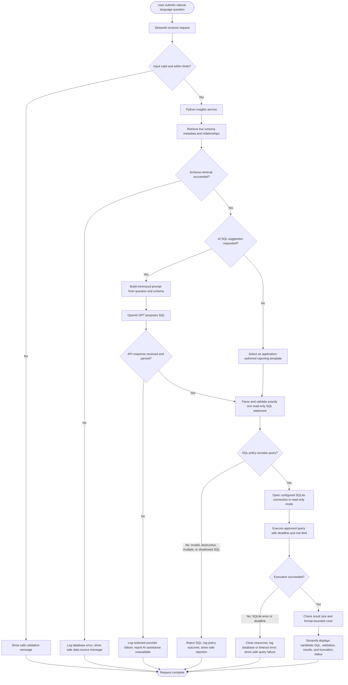

# INSIGHTSQL Data Flow

> **Status:** The main question-to-SQL-validation-to-read-only-execution flow is implemented. Optional AI result explanation and any deterministic fallback beyond the reviewed templates are not implemented.

## Normal and failure paths

Post-query AI result explanation is a proposed future feature, not part of the current application flow. The current implementation does not send query results to the provider.

## Step-by-step behavior

1. **Submission:** Streamlit submits a bounded question and presentation options to the Python service. Client-side checks are only for usability; server-side validation is authoritative.
2. **Request validation:** reject empty, oversized, malformed, or unsupported requests before building prompts or opening database work.
3. **Schema/context retrieval:** retrieve live user-table names, columns, declared types, primary keys, and foreign-key relationships from the configured database. Send schema metadata only; do not retrieve records for the SQL prompt.
4. **SQL suggestion:** GPT receives the question and minimized schema and returns an untrusted candidate. If the provider fails, the application reports that clearly and does not fabricate a successful suggestion. Reviewed templates remain available independently.
5. **SQL validation:** parse the entire candidate; require one approved read-only query and enforce table, operation, function, length, and complexity policy. Reject multiple statements and all write/DDL/admin operations before any query execution. Generated queries execute only after successful validation; no automatic repair is attempted.
6. **Controlled SQLite execution:** open the allowlisted file with `mode=ro`, enable `query_only`, install a progress-handler deadline, and execute only a validator-approved query. Enforce a maximum number of returned rows and close resources on every path.
7. **Result processing:** cap rows and output size, and format the bounded results. Mark truncated output rather than silently presenting it as complete.
8. **Display:** render the SQL candidate, validation outcome, validated SQL, bounded result table, truncation metadata, and safe errors. Never render provider output as trusted HTML.
9. **Future option:** a post-query AI explanation would require an explicit opt-in, minimized result context, and its own provider-failure handling. It is not implemented.

## Failure handling

| Failure | Required behavior |
|---|---|
| Invalid request | Reject before database or provider calls; show field-level safe guidance. |
| Schema/configuration/database error | Stop the flow, close resources, log redacted diagnostics, and report a safe data-source error. |
| Invalid or disallowed SQL | Do not execute it; record the rejection category and return a safe explanation. |
| OpenAI authentication, rate limit, timeout, network, or malformed-response failure | Report the classified safe error; the current adapter does not retry automatically. |
| SQLite query error or execution timeout | Interrupt/stop bounded work, close cursor and connection, log the classified error, and return no success-shaped result. |
| Future explanation API failure | If post-query explanation is implemented, keep validated query results and clearly mark the explanation unavailable. |
| Unexpected error | Map to a generic user-facing message; preserve redacted internal diagnostics. Correlation IDs are a future improvement. |
