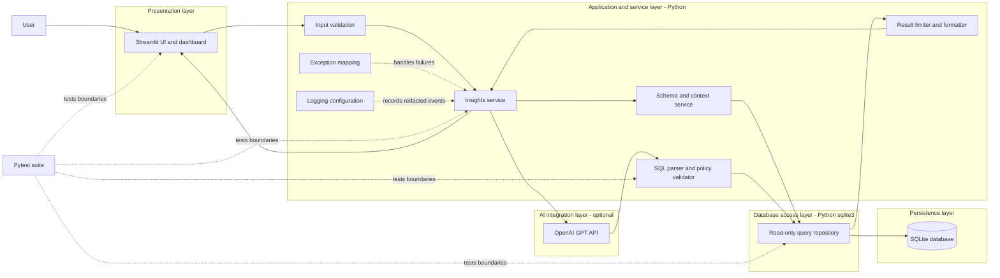
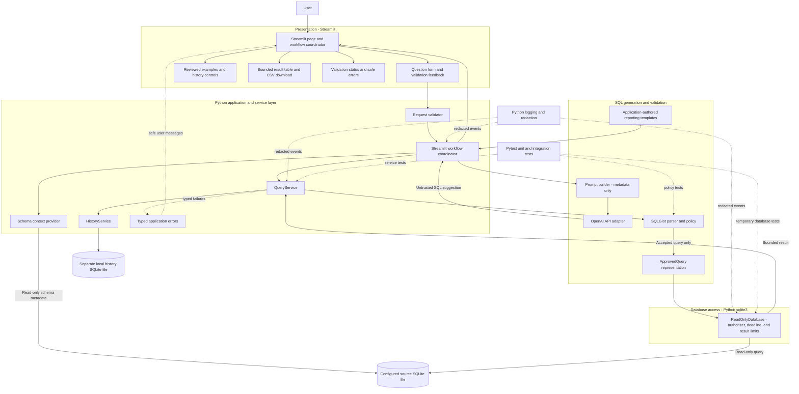
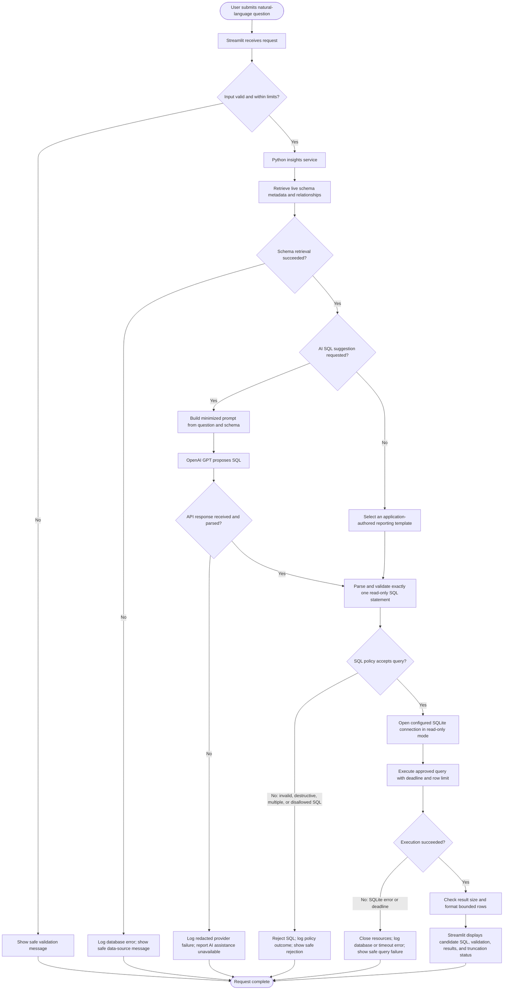
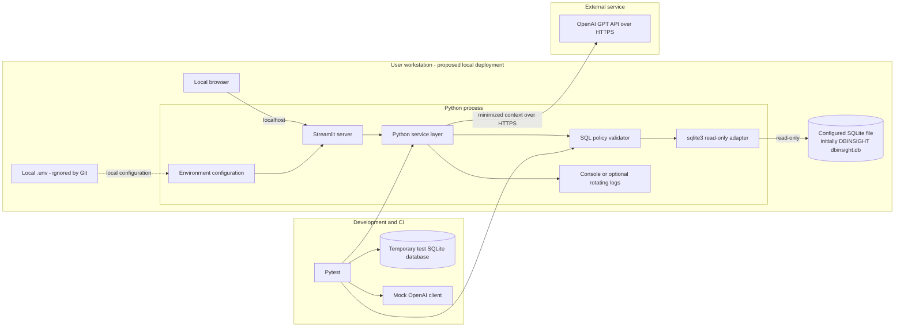

# INSIGHTSQL Mermaid Diagram Reference

> **Status:** The system, component, and data-flow diagrams describe the implemented local application architecture. The deployment diagram remains a proposed local/CI layout, not a production hosting design.

This reference collects the system architecture, component, data flow, and deployment diagrams. Related detail is in [architecture.md](./architecture.md), [component_diagram.md](./component_diagram.md), and [data_flow_diagram.md](./data_flow_diagram.md).

## A. System architecture diagram

## B. Component diagram

## C. Data flow diagram

Post-query AI result explanation is a proposed future feature, not part of the current application flow. The current implementation does not send query results to the provider. A generated candidate is executed automatically only after validation succeeds; reviewed examples are loaded and executed separately.

## D. Deployment diagram

The deployment diagram depicts a proposed single-user local setup. A hosted or multi-user deployment requires additional authentication, authorization, managed secrets, data-access governance, and operational controls.
